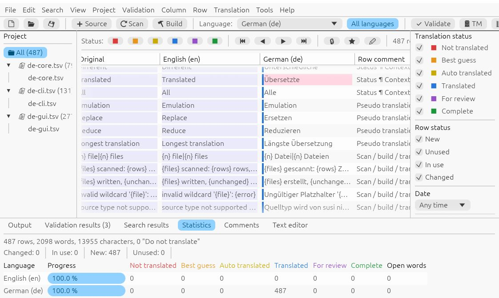

# Susi the CAT


**susi** ("Susi the CAT", CAT = computer-assisted translation) is a localization tool written in Rust. It is meant to replace the discontinued Sisulizer 4 and edits existing Sisulizer project files (`.slp`) directly.

The project consists of three parts:

| Program        | Purpose                                                                                |
|----------------|----------------------------------------------------------------------------------------|
| `susi`         | Desktop GUI modeled on the Sisulizer user interface (tree, grid, filter, output)       |
| `susi-cli`     | Command line for build pipelines, compatible with `SlMake`, also hosts the MCP server  |
| `susi-cli mcp` | MCP interface for AI agents (Model Context Protocol, stdio)                            |

Supported sources are: 

* **.NET RESX** (`.resx`) and **UWP/WinUI resources** (`.resw`, localized to `Strings/<language>/`)
* **JSON** (i18next/ngx-translate key trees)
* **PO/gettext** (`.po`/`.pot`, including compilation to `.mo`)
* **TSV i18n catalogs** (`.tsv`, the format of Susi's own catalogs; not supported by Sisulizer).
* **Java resource bundles** (`.properties`).
* **Android string resources** (`res/values/strings.xml`, localized to `res/values-b+<language>/`).
* **Flutter ARB** (`lib/l10n/app_en.arb`, Application Resource Bundles; not supported by Sisulizer).
* **WebExtension messages** (`_locales/en/messages.json` of Chrome/Firefox/Edge extensions; not
  supported by Sisulizer).
* **Qt Linguist** (`.ts` files of `lupdate`, compiled to `.qm` by `lrelease`; not supported by
  Sisulizer).



---

## Building

Prerequisites:

- Rust ≥ 1.95 (edition 2024)
- On Windows: **Visual Studio Build Tools** with the "MSVC x64" component and the Windows SDK
  (x64 CRT). Without them the linker fails with `LNK1104`. If necessary, build from the
  "x64 Native Tools Command Prompt".

```powershell
cargo build --release          # target\release\susi.exe and susi-cli.exe
cargo xtask dist               # release build (with icon and version info) and copy to dist\
cargo xtask sbom               # CycloneDX SBOM per app into dist\ (cargo install cargo-cyclonedx --locked)
cargo xtask ci                 # rustfmt --check, clippy -D warnings, all tests
cargo xtask fmt | lint | test
cargo xtask icons              # render assets\app-icon\susi.svg to susi.ico and susi-256.png
cargo xtask set-version 0.3.0  # set the workspace version in Cargo.toml and Cargo.lock (used by the release)
```

Workspace layout:

```
crates/core   susi-core: project model (.slp read/write), RESX/JSON/PO scan and build, MO,
              translation memory (TMX), Excel/CSV/TXT/XLIFF/TMX exchange, validation,
              statistics, pseudo translation, filters, settings,
              i18n (user interface language, catalogs in crates/core/src/i18n/*.tsv)
crates/mcp    susi-mcp: MCP server (rmcp, stdio)
crates/workflow
              susi-workflow: git workflow for translators (GitLab merge requests, GitHub pull requests)
apps/susi     GUI (egui/eframe)
apps/susi-cli CLI (SlMake compatible) + `mcp` task
xtask         automation (cargo xtask …)
assets        app icon (see below)
docs          architecture overview
testdata      test fixtures (see below)
.github       CI and release workflow; release tooling in package.json and .releaserc.json (see below)
```

How the applications and crates fit together (dependencies, data model, scan/build pipeline,
GUI, CLI, MCP server, git workflow, CI) is described with diagrams in the
[architecture overview](docs/architecture.md).

### App icon (`assets/app-icon/`)

`susi.svg` is the master: a cat head shaped like a speech bubble (CAT = computer-assisted
translation) in front of a translation bubble. `cargo xtask icons` renders it to `susi.ico` (16–256 px) and `susi-256.png`;
both are committed, so a normal build needs no extra tools. `apps/*/build.rs` embed the icon and
version info into `susi.exe` and `susi-cli.exe` (via `rc.exe` from the Windows SDK; without it the
build only warns, `cargo xtask dist` fails). The GUI also uses the PNG as window icon and in the
About dialog.

### Test data (`testdata/`)

The integration tests run against synthetic fixtures that are part of the workspace:

| Directory | Content | Used by |
|-----------|---------|---------|
| `testdata/projects/demo-ui/`, `demo-settings/`, `demo-widget/` | Three JSON projects (`susi\demo.slp` and the JSON files under `assets\i18n`); `demo-ui` also references a source of `demo-widget` | scan/build tests (`crates/core/tests/ops.rs`), CLI test, headless GUI tests |
| `testdata/projects/wpf-resources/` | `Resources.slp`, `Resources.resx` and the German `Resources.de.resx` as built by Sisulizer | RESX build comparison |
| `testdata/projects/custom-data/` | `Strings.resx` with pictures, an icon, byte arrays and file references, German files for them, and what Sisulizer 4.0.374 made of it (`sisulizer/scan.slp`, `translated.slp`, `Strings.de.resx`) | [images and binary data](#images-and-binary-data) in core, CLI, GUI and MCP tests |
| `testdata/slp/` | 194 further `.slp` projects of all source types (VCL, .NET, Java, Qt, HTML, databases, ...) | `.slp` round trip (`crates/core/tests/samples.rs`) |

- The fixtures are fully anonymized: every word in texts, translations, comments, keys, names and paths was
  replaced by a pseudo word of the same length, case pattern and script (Latin, Cyrillic, Greek, CJK, Hangul,
  Arabic, ...), consistently across all files, so projects and their sources still match. Binary
  data (images, icons, hashes) was replaced by random bytes. Only the file format structure remains:
  element and attribute names, class names, enumeration values, numbers, dates, escapes, whitespace
  and line endings.
- The `.slp` round trip covers all 201 projects. Projects written by Sisulizer 4.0.353 or newer
  must be reproduced byte for byte; for older ones the output must be stable.
- The tests work on copies in a temporary directory; `testdata/` itself is never modified.
- The JSON projects intentionally reproduce typical drift: `demo-ui` is in sync, `demo-settings`
  lacks two keys added to its source after the last scan, and `demo-widget` is an old project whose
  source has been rewritten since. The tests expect exactly these differences (as Sisulizer reports them).
- `.gitattributes` excludes `testdata/` from line-ending conversion, because the files are
  compared byte for byte.

### Continuous integration and releases

`.github/workflows/ci.yml` runs on every push and pull request:

1. **test** – `cargo xtask ci` (rustfmt, clippy, all tests) on Windows, Linux and macOS.
2. **semantic-release** (pushes to `main` only, after all tests passed) – [semantic-release](https://semantic-release.gitbook.io/)
   derives the next version from the commit messages since the last `v*` tag
   ([Conventional Commits](https://www.conventionalcommits.org/)):

   | Commit message                                   | Release |
   |--------------------------------------------------|---------|
   | `fix: …`, `perf: …`                               | patch (0.2.0 → 0.2.1) |
   | `feat: …`                                         | minor (0.2.0 → 0.3.0) |
   | `feat!: …` or a `BREAKING CHANGE:` footer          | major (0.2.0 → 1.0.0) |
   | `chore:`, `docs:`, `ci:`, `test:`, `refactor:`, `style:`, `build:` | no release |

   For a release it prepends the notes to `CHANGELOG.md`, sets the version in `Cargo.toml` and
   `Cargo.lock` (`cargo xtask set-version`), commits these files as `chore(release): x.y.z [skip ci]`,
   creates the tag `vx.y.z` and a draft GitHub release.
3. **build** – checks out the tag and runs `cargo xtask dist` and `cargo xtask sbom` on each
   platform; the archives `susi-the-cat-x.y.z-windows-x64.zip`, `…-linux-x64.tar.gz` and
   `…-macos-arm64.tar.gz` (with `susi`, `susi-cli`, their SBOMs `susi.cdx.json` and
   `susi-cli.cdx.json`, `README.md`, `CHANGELOG.md` and a `.sha256` file each) are attached to the
   release, and the SBOMs also on their own (`susi-the-cat-x.y.z-<platform>-susi.cdx.json`,
   `…-susi-cli.cdx.json`).
4. **publish** – publishes the draft once all archives are attached.

Notes:

- The release tooling is pinned in `package.json`/`package-lock.json` (Node.js ≥ 24.10). Local
  preview of the next version: `npm ci`, then `npx semantic-release --dry-run --no-ci` (needs a
  `GITHUB_TOKEN` with access to the repository).
- **SBOM**: [cargo-cyclonedx](https://github.com/CycloneDX/cyclonedx-rust-cargo) (pinned in the
  workflow) writes CycloneDX 1.6 JSON per application with the dependencies built for that platform
  (versions, licenses, package URLs, crates.io checksums, dependency graph). Build dependencies are
  listed with scope `excluded`, dev-dependencies and the release tooling are not included. The
  timestamp is the commit time (`SOURCE_DATE_EPOCH`), so the SBOM is reproducible. Tools such as
  syft, grype or Dependency-Track read it directly. (syft itself finds no dependencies in plain
  Rust executables and lists the whole workspace, npm tooling included, when scanning the sources.)
- The tag of the last release must exist (initially `v0.2.0`); without any `v*` tag semantic-release
  would start with 1.0.0.
- If `main` is a protected branch, the GitHub Actions bot must be allowed to push the release commit.
- The Linux and macOS builds are unsigned plain executables (no installer, no `.app` bundle). On macOS
  remove the quarantine flag after download: `xattr -d com.apple.quarantine susi susi-cli`.

---

## User interface (`susi`)

```powershell
.\susi [project.slp]
```

Operation follows Sisulizer:

- **Menus**: File, Edit, Search, View, Project, Validation, Column, Row, Translation, Tools,
  Help. Keyboard shortcuts: `Ctrl+S`, `Ctrl+O`, `Ctrl+N`, `Ctrl+F`, `F5` (scan),
  `F9` (build). The current language is selected at the end of *View* (or by clicking a cell).
- **Project tree** (left): "All", with the sources and their nodes below. The context menu offers
  properties, scanning/building a single source, setting the status of all rows of a node and
  "Remove source".
- **Translation grid** (center):
  - Columns for context, status, original and one column per language (or only the selected
    language with its comment). Context and original have a lavender background, problem cells
    a pink one.
  - "Translated on" shows when the translation of the selected language was last edited; its
    tooltip also shows when the row was created and when its original changed (*View* toggles
    the column).
  - Sorting: clicking the header of "Translated on" cycles through newest first → oldest first →
    unsorted (document order); rows without a translation date stay at the end. Clicking
    "Context" cycles through A–Z → Z–A → unsorted. An arrow marks the sorted column.
  - A colored bar shows the translation status, a triangle indicates a comment, a camera
    a [screenshot](#screenshots).
  - The grid scrolls horizontally and vertically; the header row stays fixed. Resize columns by
    dragging the separator in the column header; a double-click resets the width.
  - In-cell editing: `F2`/`Enter` or double-click; `Enter` accepts and moves to the next row,
    `Esc` cancels. Double-clicking multi-line text opens it in the Editor tab.
  - Editing changes the status *Not translated*, *Best guess* or *Auto translated* to
    *Translated*.
  - Row and column commands have the same names and order: *Status*, *Copy from* (a submenu with
    *Original* and the other project languages, e.g. to fill `de-CH` from `de`) and *Clear
    translation*. The row commands (menus *Row* and *Edit*, context menu of a cell) change the
    selected cell. The column commands (menu *Column* for the current language, or right-click the
    header of a language or status column) change the visible rows: copying opens a dialog
    (empty cells only, or also overwriting translations), clearing asks for confirmation. Copying
    skips rows marked "Do not translate", excluded rows and rows without text to copy, and
    changes the status like editing; clearing also removes the translation comments.
- **Filter** (right): translation status, row status (new, modified, unused, in use), date,
  marked, locked, with/without screenshot and text. When a filter is active, the notice "Special filters on!" appears.
  See [Reviewing recent changes](#reviewing-recent-changes).
- **Bottom tabs**:
  - Output, Validation (a click jumps to the cell), Search (including "Use as filter"),
    Statistics and Comments.
  - The lists in Output, Validation, Search and Comments scroll horizontally like the grid, and
    their columns can be resized the same way (widths last until the program is closed).
  - Editor: original, translation, comments, properties and translation memory suggestions with
    "Apply". For pictures and binary data: both pictures (or a hex dump) with *Load…*, *Link to
    file…*, *Remove file link* and *Save as…*, see [Images and binary data](#images-and-binary-data).
  - Screenshots: the screenshots of the selected row with its marked area, see
    [Screenshots](#screenshots).
- **Dialogs**: Languages, Add source, Source properties (write method, output pattern, excluded
  data types of RESX sources),
  Row properties, Export, Import, Translate with translation memory, Pseudo translation,
  Screenshots, Options.

Unsaved changes are prompted for when closing, opening or creating a project.

### Reviewing recent changes

Like Sisulizer, Susi stores three timestamps (local time) in the `.slp` file:

| Timestamp | Set when | Date filter (`-datetype:`) |
|-----------|----------|----------------------------|
| Row created | a scan finds a new string | `created` |
| Original changed | a scan finds a changed original text | `changed` |
| Translation date (per language) | a translation is edited, imported, translated from the TM or pseudo translated | `translated` |

The date filter shows rows whose selected timestamp (or any of them) lies in a period:
*Today*, *Last 7 days*, *Last 30 days* or *Period…* with "From"/"To" (e.g. `2026-11-01`,
`01.11.2026 14:30`, `today`, `yesterday`, `7d`, `12h`; a date without time covers the whole day).
Translation dates are only checked for the shown languages (single-language view: the selected
one). The same filter is available in the CLI (`export`, `validate`, `report`) and in the MCP tool
`list_rows`:

```powershell
# Excel file with all German translations of the last 7 days for review
susi-cli export Review.xlsx -lang:de -since:7d -datetype:translated app.slp
# Strings that are new since a release
susi-cli export New.xlsx -since:2026-11-01 -datetype:created app.slp
```

Deleted translations and earlier texts leave no trace in the project; to compare with an older
state, compare the `.slp` file with its version in the source control.

---

## User interface language (English/German)

GUI and CLI are available in English and German. English is the default and fallback language.

- **GUI**: *Tools → User interface language* or *Tools → Options…*: "Automatic (system language)",
  "English" or "Deutsch". The change takes effect immediately and is stored in `settings.json`
  (`ui_language`). Automatic means: `SUSI_LANG`, otherwise the system language, otherwise English.
- **CLI**: precedence is `-uilang:de|en|auto` (also `--uilang=de`) → environment variable
  `SUSI_LANG` → GUI setting → system language → English. For build pipelines a fixed language is
  recommended, e.g. `-uilang:en`.
- **MCP** always answers in English.
- **Exchange files** (Excel/CSV/text) get column headers, status names and the worksheet name in
  the user interface language. The export dialog offers another language (*Language of column
  headers and status values*; the choice is remembered in `settings.json`,
  `export_label_language`); in the CLI `-uilang:` decides. On import, headers and status names
  are recognized in every user interface language, regardless of the current one.

Texts are written in English in the code and serve as keys. The catalogs
`crates/core/src/i18n/de-*.tsv` (`core`, `cli`, `gui`) contain one entry per line:
`context<TAB>English<TAB>translation`. If an entry is missing, the English text is shown.
`cargo test -p susi-core i18n` checks that every translatable text has an entry, that no entry is
orphaned and that the `{placeholders}` match.

To add another language, create `xx-*.tsv` and register it in `LANGUAGES` in
`crates/core/src/i18n.rs`.

### Translating Susi

Susi maintains its own catalogs: `crates/core/src/i18n/susi-i18n.slp` has the four German
catalogs as TSV sources (original language English, see [TSV catalogs](#tsv-catalogs)).
`cargo test -p susi-core i18n` checks that the project covers all catalogs and that building it
reproduces them byte for byte.

- **New or changed texts**: add/change the line in `de-*.tsv` (with or without German translation),
  then `susi-cli scan crates\core\src\i18n\susi-i18n.slp`. The scan takes over German translations
  into empty cells. Translate the remaining rows in Susi and build (*Project → Build* or
  `susi-cli create crates\core\src\i18n\susi-i18n.slp`).
- **Changed translations**: edit them in Susi and build; the project is authoritative.
- **New language** (e.g. French): add it to the project and build. The output pattern
  `<iso>-core.<ext>` creates `fr-core.tsv` etc.; register the files in `LANGUAGES`.

---

## Command line (`susi-cli`, SlMake compatible)

```
susi-cli <tasks> project.slp [-q] [-a] [-w] [-e] [-h]
```

| Task | SlMake | Description |
|------|--------|-------------|
| `add [file]` | – | Add a source (.json/.resx/.resw/.po/.pot/.tsv/.properties/Android .xml/.arb/Qt .ts/`_locales/<lang>/messages.json`, wildcards allowed); creates the project if needed. `-type:json\|resx\|po\|tsv\|properties\|android\|arb\|webext\|ts` checks the type |
| `scan` | `scan` | Scan sources |
| `create` (`build`, `make`) | `create` | Create localized files (default task) |
| `export [file]` | `export` | Export to `.xlsx`, `.csv`, `.txt`, `.xlf`, `.tmx` |
| `import [file]` | `import` | Import from the same formats |
| `translate` | `translate` | Translate using the translation memory |
| `savetotm` | – | Save translations to the TM |
| `duplicate` | `duplicate` | Translate duplicate strings |
| `copy` | – | Copy the original or another language (`-from:`) into the `-lang:` languages, e.g. `de-CH` from `de`; empty cells only unless `-overwrite` (GUI: *Copy from*) |
| `validate` | `validate` | Validate translations |
| `report [file]` | `report` | Report (`.html`, `.txt`, `.json`, otherwise stdout) |
| `remove` | `remove` | Remove unused rows |
| `fillpseudo` / `removepseudo` | same | Pseudo translation |
| `info` | – | Languages, sources, progress, pictures and binary data, screenshots |
| `mcp` | – | Start the MCP server |
| `screenshot [action]` | – | Manage [screenshots](#screenshots): `list`, `add`, `link`, `unlink`, `remove`, `prune`, `refresh`, `import` (manifest of UI tests) |

Important options are `-lang:de;fr`, `-status:…`, `-include:` and `-exclude:` (sources),
`-since:`, `-until:` and `-datetype:` (date filter, see
[Reviewing recent changes](#reviewing-recent-changes)),
`-overwrite`, `-from:` (copy), `-tm:[file]`, `-fuzzy:N`, `-screenshots:auto|none|link|embed` (export), `-nosave`
and `-forcesave`. Instead of `-opt:value`,
`--opt=value` is accepted as well. `-uilang:en|de` selects the output language. `susi-cli <task> -h`
prints help for a task.

**Exit codes**:

- With `-w`: `2` on errors, `1` on warnings, otherwise `0`.
- Without `-w`: `1` on errors, otherwise `0`.

Pipeline example:

```powershell
susi-cli scan create -w app.slp
susi-cli copy -from:de -lang:de-CH create -lang:de-CH app.slp
susi-cli validate -lang:de -w app.slp
susi-cli export open.xlsx -lang:de;fr -status:untranslated app.slp
```

**Checks** of `validate` (`-check:a;b`, default: all except `missing`; GUI: *Validation*):

| Keyword | Checks | Severity |
|---|---|---|
| `missing` | Untranslated rows | Warning |
| `format` | Placeholders: .NET `{0}`/`{name}`, i18next `{{x}}`, printf `%s`, Qt `%1`/`%L1`/`%n`, WebExtension `$NAME$`; ICU messages by their arguments (`{count, plural}`) | Error |
| `tags` | Markup tags (`<b>`, `<br/>`) | Error |
| `whitespace`, `newline` | Leading/trailing spaces, line breaks | Warning |
| `period`, `colon`, `exclamation`, `question` | End punctuation (including full-width and Spanish forms) | Warning |
| `length` | Maximum number of characters of the row | Error |
| `allspaces` | Translation consists of spaces only | Error |
| `hotkey` | Number of `&` mnemonics | Warning |
| `duplicate` | The same original translated differently | Warning |
| `control` | Control characters such as DEL in originals and translations | Error |
| `icu` | ICU MessageFormat syntax of translations and of originals that use it: braces, the mandatory `other` case, plural categories (a translated `eins{…}`), argument types | Error |
| `icucases` | ICU plural forms the target language needs (CLDR, e.g. Polish `few` and `many`; `=1` counts as `one`) and the select cases of the original | Warning |
| `screenshot` | Linked screenshot image missing | Warning |
| `data` | Pictures and binary data: linked file missing, picture translation of another format or size, translation of a picture that is no picture | Warning |

**Test reports in GitLab CI**: `validate -junit:file` also writes the result to a
[JUnit XML report](https://docs.gitlab.com/ci/testing/unit_test_reports/). Errors become failed
tests, with `-w` warnings as well (the same rule as for the exit code); without findings the file
is still written, without tests. Each finding is a test case named `[language] context: check`
in a suite per source, with the message, the original and the translation as failure text.
GitLab shows them in the merge request and in the pipeline's *Tests* tab:

```yaml
susi-validate:
  stage: test
  script:
    - susi-cli validate -junit:susi-junit.xml -w l10n/app.slp
  artifacts:
    when: always
    reports:
      junit: susi-junit.xml
```

SlMake options without an equivalent in susi (e.g. `-ignorecase`) are ignored with a notice.
Unsupported tasks and translation engines (`-engine:` other than `tm`) abort with an error
message.

---

## MCP interface for AI agents

Configuration, e.g. in VS Code `mcp.json` or in the Copilot CLI:

```json
{ "servers": { "susi": { "command": "susi-cli", "args": ["mcp"] } } }
```

Optionally a project is opened right away: `"args": ["mcp", "C:\\path\\app.slp"]`.

Tools (31):

- `open_project`, `create_project`, `save_project`, `project_info`
- `list_rows` (filters including the date range `since`/`until`/`date_field` and
  `has_screenshot`, paging; rows carry their created/changed and translation dates and their
  screenshots), `get_row`
- `get_screenshot` (the image itself plus the rows it shows), `attach_screenshot`,
  `detach_screenshot` (see [Screenshots](#screenshots))
- `set_translations` (batch; default status *Auto translated*), `set_status`,
  `set_row_properties`
- `copy_translations` (the original or another language into one language, for all rows, a
  source or given keys, without passing the texts through the agent; like *Copy from* in the GUI)
- `get_picture` (a picture row as image content), `load_translation_file` (translation of a
  picture or binary row from a file, linked by default; see [Images and binary data](#images-and-binary-data))
- `add_language`, `add_source`, `scan`, `build`
- `validate`, `statistics`
- `tm_translate`, `tm_lookup`, `tm_save`
- `export`, `import`, `fill_pseudo`
- `workflow_status`, `workflow_fetch`, `workflow_save`, `workflow_publish` (see [Git workflow](#git-workflow-gitlab-github))

A typical agent workflow:

1. `open_project`
2. `list_rows` with status "untranslated"
3. `set_translations`
4. `validate`
5. `save_project`

A human then reviews the translations in the GUI and sets them to *Translated* or *Complete*.

---

## Git workflow (GitLab, GitHub)

Translators work in a git working copy without knowing git: a developer prepares the working
copy once, and Susi then offers three plain-language actions (GUI menu and toolbar *Workflow*,
`susi-cli workflow`, MCP tools `workflow_*`):

| Action                                 | What happens                                                                                                                                   |
|----------------------------------------|------------------------------------------------------------------------------------------------------------------------------------------------|
| **Get translation project**            | `git fetch`, check out the latest commit of the default branch, clean up. Uncommitted changes go to `git stash`, local commits to a backup branch. |
| **Save changes**                       | Build (optional), save the project, create a personal branch (`l10n/{user}/{date}`) when on the default branch, commit the project files and push. |
| **Prepare publication**                | Create or update a GitLab merge request or GitHub pull request with reviewers (configured names or previous committers).                       |

The status bar shows the state (*Up to date*, *Update available*, *Changes not saved on the server*,
*Saved, not published*, *In review*, *Published*, *Fixed version*) and a hint for the next step;
clicking it asks the server. The last known merge request per branch is remembered in
`.git/susi/merge-requests.json`, so *In review* also shows offline and after further saves.
*Advanced settings* in the dialogs allow another branch, a specific
commit/tag (read-only), another target branch, the commit prefix and CI skipping.

Only the `.slp` file, the sources and outputs referenced by the project and `git.paths` are
committed – never other changes in the working copy.

### Setup (developer)

1. Clone the repository, then `susi-cli workflow init app.slp` creates `.susi/workflow.toml`;
   adjust and commit it **to the default branch**. The workflow is active when this file (or the working
   copy file below) exists. *Get translation project* never sets `.susi/` aside; if the checked-out
   version lacks the file, it is kept as an uncommitted file and the status warns about it.
2. Configure git for the translator: `git config --global user.name/user.email` and a credential
   helper (`git config --global credential.helper manager` on Windows). For working copies owned by
   another user: `git config --global --add safe.directory <path>`.
3. Create an access token and store it with *Workflow → Sign in to the server…* or
   `susi-cli workflow login app.slp` (reads stdin):
   - **GitLab**: personal access token with the scope `api` (role Developer or higher).
   - **GitHub**: fine-grained personal access token for the repository with the repository
     permissions *Contents* and *Pull requests* (read and write), or a classic token with the
     scope `repo`. Organizations with SAML single sign-on require the token to be authorized for
     the organization. Alternatively `token = "credential"` uses the login of git itself (Git
     Credential Manager signs in to GitHub with a token that may call the API).

### Configuration

Three TOML files with the same structure are merged (later files win):

1. user defaults: `%APPDATA%\susi\workflow.toml`,
2. repository: `.susi/workflow.toml` (checked in, shared by the team),
3. working copy: `.git/susi/workflow.local.toml` (inside `.git`, can never be committed).

```toml
[forge]
provider = "auto"          # auto (github.com: github, otherwise gitlab) | gitlab | github | none (git only)
# url = "https://gitlab.example.com"   # default: derived from the remote URL
# project = "group/app"    # GitHub: owner/repo
token = "auto"             # auto | env:VARIABLE | credential | credential:<user> | none

[git]
remote = "origin"
# default_branch = "main"  # default: the remote's default branch
branch_pattern = "l10n/{user}/{date}"   # placeholders {user} {date} {time} {project}
# paths = ["docs/i18n"]    # further files saved together with the project

[save]
message = "Update translations ({project})"
semantic_prefix = "fix"    # fix = patch release, feat = minor release, chore = no release, "" = none
ci_skip = false            # GitLab: push option ci.skip, GitHub and others: "[skip ci]" in the message
build = true

[publish]
title = "Translations: {project} ({user}, {date})"
description = "Translations updated with Susi."
reviewers = []             # user names (GitHub teams: org/team)
assign_as = "reviewers"    # reviewers | assignees | both (GitHub teams can only review)
offer_committers = true
squash = false             # GitLab only (GitHub: repository settings)
remove_source_branch = true
```

`publish.assign_as` decides how the people chosen in *Prepare publication* (`reviewers`, the
dialog, `-reviewer:`) are entered in the merge request: as **reviewers** (default), as
**assignees** (for teams that work with assignees) or as **both**. When a merge request is
updated, only the configured role changes; the other one stays as it is. GitLab Free keeps only
one reviewer and one assignee per merge request.

### GitHub

With `provider = "auto"` (the default), remotes on `github.com` and GitHub Enterprise Cloud
(`*.ghe.com`) use GitHub; GitHub Enterprise Server needs `provider = "github"` and, if the remote
URL does not show it, `url = "https://github.example.com"` (API: `<url>/api/v3`).

- Pull requests take the place of merge requests (`#12` instead of `!12`); the dialogs and
  messages use GitHub's terms.
- Reviewers are user logins or teams written as `org/team`. Users are checked against the
  repository's collaborators before the pull request is created; the author cannot review their
  own pull request and is left out. Reviewer candidates are the collaborators (or, without push
  access to that list, the users who can be assigned).
- Assignees (`assign_as = "assignees"` or `"both"`) are users only; the author may be assigned. With
  `"both"`, teams are requested as reviewers and not assigned; with `"assignees"`, a team is
  rejected before the pull request is created.
- Squashing and deleting the branch after merging are no per-pull-request settings on GitHub:
  they are chosen when merging and configured in the repository settings (*Automatically
  delete head branches*), so the dialog does not offer them.
- *Skip the CI pipeline* writes `[skip ci]` into the commit message, which GitHub Actions honors.

**Secrets**: configuration files only hold *references* to the token. Values that look like a token
(`glpat-…`, `ghp_…`, `github_pat_…`) are rejected. `auto` uses the environment variable `SUSI_FORGE_TOKEN`, then the
token stored with git's credential helper (Windows Credential Manager); `credential` uses the git
credentials themselves.

### Command line and MCP

```powershell
susi-cli workflow status -online app.slp
susi-cli workflow fetch app.slp
susi-cli workflow save -message:"Spanish texts" -prefix:feat app.slp
susi-cli workflow save publish -reviewer:anna app.slp
```

MCP: `workflow_status`, `workflow_fetch` (refuses to discard unsaved changes unless
`discard_changes`), `workflow_save`, `workflow_publish`. The crate `susi-workflow` keeps the server
behind the trait `Forge` (implementations for GitLab and GitHub).

---

## Screenshots

Screenshots show translators where a text appears, how much space it has and what it refers to.
A screenshot is linked to one or more rows, optionally with the area where the text appears.

**Storage.** Screenshots are kept next to the project, never in the `.slp`: Sisulizer drops
unknown content when it saves a project, and embedded images would bloat the file.

```
app.slp
app.files/
  screenshots.json             screenshots and their links
  screenshots/
    login-dialog.3f9a2c1d.png
```

Image names contain the first characters of the SHA-256 hash of the content, so an unchanged
image is never copied twice and git sees a replaced image as a new file. The folder is saved
together with the project (also by the [git workflow](#git-workflow-gitlab-github)), and
*Save as* copies it to the new name.

```json
{
  "version": 1,
  "screenshots": [
    {
      "id": "login-dialog",
      "file": "login-dialog.3f9a2c1d.png",
      "title": "Login dialog",
      "width": 1280, "height": 800,
      "created": "20261118101500",
      "origin": "../ui-tests/out/login.png",
      "origin_hash": "3f9a2c1d…",
      "links": [
        { "source": "src\\assets\\i18n\\en.json", "key": "en.json/LOGIN.TITLE", "area": [120, 40, 260, 24] }
      ]
    }
  ]
}
```

- `key` is the context of a row (as in the *Context* column and in exchange files) or a row id;
  the wildcards `*` and `?` select several rows. `source` restricts the key to one source.
- `area` is `[x, y, width, height]` in image pixels.
- `origin` is the file the image was taken from; *Refresh* (`screenshot refresh`) reads changed
  origin files again, the links stay.
- Links to rows that no longer exist (for example after *Remove unused rows*) are shown as
  orphaned; *Clean up* (`screenshot prune`) removes them and unused image files.

**User interface.** The *Screenshots* tab shows the screenshots of the selected row with its area
highlighted (the areas of other rows faintly). Images are added with *Add…*, by pasting
(`Ctrl+V`) or by dropping image files on the window; *Mark area* lets you drag a rectangle over
the image. The context menus of rows and tree nodes add a screenshot to the row, the view or a
node. *Project → Screenshots…* lists all screenshots with title, size and links. A new project
must be saved before it can have screenshots.

**UI tests.** UI tests (e.g. Playwright) can write a manifest with the schema of
`screenshots.json`; `file` is relative to the manifest and is the only required field:

```json
{ "screenshots": [
  { "id": "login", "file": "login.png", "title": "Login dialog",
    "links": [ { "key": "*LOGIN.TITLE", "area": [120, 40, 260, 24] } ] } ] }
```

```powershell
susi-cli screenshot import ui-tests\out\screenshots.json -prune app.slp
```

The import adds or replaces the listed screenshots (importing the same manifest again changes
nothing); `-prune` removes the screenshots that are missing in the manifest. Further actions:
`susi-cli screenshot -h`.

**Export.** Screenshots of the exported rows are included (`-screenshots:`, export dialog):

| Format    | `auto` (default)                                                                                                       | `link`                                                       |
|-----------|------------------------------------------------------------------------------------------------------------------------|--------------------------------------------------------------|
| Excel     | Second worksheet *Screenshots*: each image once with numbered frames around the marked areas and a table *No. / Context / Original*; the *Screenshot* column links to it (`embed`) | *Screenshot* column with links to the images copied to `<name>_screenshots/` |
| CSV, TXT  | *Screenshot* column with relative paths of the images copied to `<name>_screenshots/`                                  | same                                                         |
| XLIFF 1.2 | `<context-group purpose="information">` per trans-unit with `x-screenshot` (path) and `x-screenshot-area`; images copied | same                                                         |
| TMX       | –                                                                                                                      | –                                                            |

`none` turns screenshots off. The import ignores the screenshot column and the second worksheet.

**MCP and validation.** `list_rows` and `get_row` return `screenshots: [{id, title, area}]`, and
`get_screenshot` returns the image itself, so AI agents can look at it before translating. The
validation check `screenshot` reports rows whose screenshot image is missing.

---

## Images and binary data

Like Sisulizer (*Custom Data*), Susi localizes pictures and other binary data of `.resx` files and
shows and translates the picture and binary rows of Sisulizer projects of any source type.

**What a scan finds** (verified against Sisulizer 4.0.374, fixture `testdata/projects/custom-data/`):

| RESX entry | Row |
|---|---|
| String, `ResXFileRef` to a text file (`System.String;…;utf-8`) | Text row with the text (file content) |
| Embedded byte array (`bytearray.base64`: bitmap, icon, `byte[]`) or `ResXFileRef` to another file, whose content is a PNG, JPEG, GIF, BMP, ICO or CUR picture | Picture: `TImageDataNode` with a `TPictureRow` |
| The same with other content | Binary data: `TBinaryDataNode` with a `TBinaryRow` |

- The format is detected by the content, as Sisulizer does for .NET resources; there is no format
  choice per resource (Sisulizer offers it only for Windows resources and database fields and
  discards it for .NET resources). XML and HTML data, which Sisulizer splits into texts, are
  plain binary data in Susi; such nodes of Sisulizer projects are kept untouched.
- Pictures are stored as hex in the `.slp` like Sisulizer does (lines ending in column 78),
  binary data only as a fingerprint (`thumbnail`: first 8 and last 3 bytes); Susi reads the
  original of binary data from the `.resx` when it is shown or saved. A changed original marks
  the row *Changed* and its translations *For review*.
- *Source properties → Excluded data types* (`excludeddatatypes`) skips pictures, binary data or
  text files on the next scan; rows no longer scanned become unused.

**Translating.** The editor tab shows the original and the translation (pictures, otherwise a
hex dump). *Load…* takes a file as translation, *Link to file…* also keeps it linked
(Sisulizer: *Row | Link to File*): a changed linked file is read again when the project is
opened, scanned or built (GUI, CLI, MCP). Susi compares the content, not the file date, so a git
checkout changes nothing. *Save as…* saves the original or the translation, e.g. as a template
for a localized picture. Translations are stored in Sisulizer's form, as hex in `<lang>` plus
`filename` (relative to the project) and `filedate` when linked, so Sisulizer loads and builds
them. Linked files are saved together with the project by the
[git workflow](#git-workflow-gitlab-github). The validation check `data` reports missing linked
files and picture translations with another format or size than the original.

**Building.** A localized `.resx` contains the translated entries only (like Sisulizer's
satellite files): pictures and binary data embedded as byte arrays (also for former file
references, with the type of the reference), text file references as strings. Unlike Sisulizer,
Susi always writes the `mimetype` of embedded data (Sisulizer omits it for former `byte[]` file
references, which .NET then cannot read).

CLI: `scan` and `create` read changed linked files first, `info` counts the pictures and binary
rows. MCP: rows with `data` instead of text, `get_picture` (the picture as image content) and
`load_translation_file`.

## Files and formats

- **Project**: Susi/Sisulizer `.slp` (XML). Unknown elements and attributes are preserved on save.
  A backup `*.~slp` is created before saving.
- **Output**:
  - RESX by default `<body>.<net>.<ext>` (e.g. `Strings.de-DE.resx`), JSON `<sl>\<file>`,
    PO `<iso>\<body>.po` (e.g. `de\messages.po`, with `messages.mo` next to it), TSV: the language
    code in the file name is replaced (`de-core.tsv` → `<iso>-core.<ext>`), otherwise `<iso>\<file>`,
    Java properties `<body>_<iso>.<ext>` (e.g. `Messages_de.properties`, `Messages_pt_BR.properties`),
    Android `<parent>\values-b+<android>\<file>` (e.g. `res\values-b+de\strings.xml`,
    `res\values-b+pt+BR\strings.xml`), RESW `<parent>\<net>\<file>` (e.g.
    `Strings\de\Resources.resw`), ARB: the language code in the file name is replaced
    (`app_en.arb` → `app_<iso>.<ext>`), WebExtension messages `<parent>\<iso>\<file>` (e.g.
    `_locales\pt_BR\messages.json`), Qt TS: the language code in the file name is replaced
    (`app_de.ts` → `app_<iso>.<ext>`).
  - Patterns from the project's `<outputfile>` are evaluated: `<dir>`, `<parent>`, `<file>`,
    `<body>`, `<ext>`, `<sl>`, `<iso>`, `<ish>`, `<net>`, `<tag>`, `<win>`, `<lang>`,
    `<android>` (BCP 47 subtags joined by `+`: `de`, `pt+BR`, `zh+Hans`) and `<androidr>` (legacy
    Android qualifier: `de`, `pt-rBR`, `zh-rCN`, `iw` for Hebrew).
- **Translation memory**: TMX, by default `%APPDATA%\susi\susi-tm.tmx` (configurable). Exact
  matches get the status *Auto translated*, fuzzy matches *Best guess*.
- **Settings**: `%APPDATA%\susi\settings.json`. The directory can be overridden with
  `SUSI_CONFIG_DIR`.
- **Exchange**: Excel `.xlsx`, `.csv`, tab-separated `.txt`, XLIFF 1.2 (`.xlf`, one file per
  language when several languages are exported) and `.tmx`.
- **Screenshots**: `<project>.files/` next to the project, see [Screenshots](#screenshots).
- **Pictures and binary data** of RESX sources: hex in the `.slp` like Sisulizer, translations
  optionally linked to files, see [Images and binary data](#images-and-binary-data).

---

## PO localization (gettext)

A `.pot` template or a `.po` file is added like any other source (GUI: *Add source*, CLI:
`susi-cli add locale\messages.pot -lang:de;fr app.slp`).

- **Scan**: Each entry becomes a row. The row ID is `msgid` or `msgctxt|msgid`. Plural forms
  appear as `id[0]`, `id[1]`, … (count configurable, default 3, maximum 6). Comments (`#`, `#.`,
  `#:`) are imported as notes. The header fields `Last-Translator` and `Language-Team` are
  translatable as well.
- **Build**: The localized `.po` keeps comments, references and order. `Language`,
  `Content-Type` (UTF-8), `Plural-Forms` (matching the target language) and `PO-Revision-Date` are
  added or updated. Rows with status *For review* or *Best guess* get the `fuzzy` flag.
  Untranslated entries stay empty (gettext then falls back to the original).
- **MO**: With the option *Compile created PO files to binary MO files*, an additional `.mo` file
  is created. Fuzzy entries are skipped, as are incomplete entries unless *Include empty
  translations into MO files* is set. The byte order is selectable.
- **Options** (source properties, *PO options* section): scan comments, compile, use msgstr value
  as original, include empty translations, byte order, number of plural rows. The options are
  stored under the Sisulizer attribute names (`compile`, `scancomments`, `usevalueasoriginal`,
  `includeempty`, `byteorder`, `pluralforms`).

Note: Sisulizer's row ID scheme for PO is unknown. Older Sisulizer projects with PO sources may
therefore get new row IDs on the first scan. This has not been verified for lack of sample
projects.

---

## TSV catalogs

Tab-separated catalogs as used by Susi and PhotoCraft: one entry per line,
`context<TAB>original<TAB>translation`, comments start with `#`, escapes `\n`, `\t`, `\r`, `\\`.
The context `@plural` marks plural entries (`one|other`, translation forms separated by `|`); other
contexts disambiguate equal texts. Sisulizer has no such source type, so the project stores them
with the Susi-specific class `TTsvSource` (Sisulizer 4 cannot open such projects).

- **Scan**: Each entry becomes a row; the row ID is the original as written in the file, prefixed
  by `context|` if there is a context. The comment block heading a section and the context become
  the note. A catalog often already is the translation of one language (`de-core.tsv`: English
  originals, German translations): the scan takes over existing translations from the localized
  files of all project languages, including the original file itself, into empty cells.
- **Build**: Only the third column is rewritten; comments, blank lines, order, BOM and line endings
  are kept. Untranslated entries keep an empty third column, which the Susi catalog loader treats
  as "show the original". The localized file of a language may be the original file itself.

---

## Java properties

Java resource bundles (`Messages.properties` with `Messages_de.properties`, `Messages_pt_BR.properties`
etc. next to it) are stored with Sisulizer's class `TJavaResourceSource`, so Sisulizer projects with
`.properties` sources can be opened, scanned and built. `.java` ListResourceBundles (the same
Sisulizer source type) are preserved but not supported.

- **Scan**: The file is read like `java.util.Properties.load` does (`key=value`, `key: value`,
  `key value`, continuation lines, `#`/`!` comments, escapes including `\uXXXX`). Each key becomes a
  row (row ID = key, as in Sisulizer); the comment lines directly above an entry become its note.
  Entries with empty values are skipped. When the source is added, translations from existing
  localized files (`Messages_de.properties`, …) are taken over into empty cells.
- **Build**: The original is copied with the translated values; comments, blank lines, order,
  separators and line endings are kept. Omitted entries (write method) are removed together with
  their comment lines, so Java falls back to the parent bundle.
- **Encoding** (source properties): *Automatic* keeps the style of the original: raw UTF-8 if it
  contains UTF-8 text, otherwise ASCII with `\uXXXX` escapes, which all Java versions read (Java 8
  and older read `.properties` as ISO-8859-1). *UTF-8* writes non-ASCII characters as they are
  (Java 9+), *ISO-8859-1 with Unicode escapes* always escapes them. The choice is stored in the
  Sisulizer attribute `encoding` (Sisulizer's `windows-1252` means escaped).

---

## Android string resources

An Android values file (usually `app/src/main/res/values/strings.xml`, the default resources) is
added like any other source (GUI: *Add source*, CLI:
`susi-cli add app\src\main\res\values\strings.xml -lang:de;pt-BR app.slp`). It is stored with
Sisulizer's class `TAndroidValuesSource`, the rows in a `TAndroidValuesGroup` node `string`, as
Sisulizer does. Sisulizer's `TAndroidSource` (complete Android projects/APKs) is preserved but not
supported.

- **Localized files** go to the BCP 47 resource directories `values-b+<language>[+<region>]` of
  Android 7.0 (API 24) and newer, as recommended by the Android documentation
  ([Support different languages](https://developer.android.com/training/basics/supporting-devices/languages)):
  `res/values-b+de/strings.xml`, `res/values-b+pt+BR/strings.xml`, `res/values-b+zh+Hans/strings.xml`.
  If the project already has localized copies in legacy directories (`values-de`, `values-pt-rBR`)
  and none in `values-b+…` directories, adding the source chooses the legacy pattern
  `<parent>\values-<androidr>\<file>` instead, because both forms of the same locale would be
  duplicate resources. Further qualifiers of the original directory are kept
  (`values-night` → `values-b+de-night`).
- **Scan**: `<string>` (also `<item type="string">`), the items of `<string-array>` and the
  quantities of `<plurals>` become rows. Row IDs: the resource name, `name[0]`, `name[1]`, … for
  array items, `name[one]`, `name[other]`, … for plurals; a `product` attribute is appended as
  `[product=tablet]`. Skipped: `translatable="false"`, references (`@string/…`, `?attr/…`), empty
  values and all other resource types (colors, dimensions, styles, …). The XML comments directly
  above a resource become its note (a blank line separates file or section comments). When the
  source is added, translations from existing localized files are taken over into empty cells.
- **Texts** are shown the way Android displays them: entities and Android escapes (`\'`, `\"`,
  `\n`, `\t`, `\@`, `\?`, `\uXXXX`) are resolved, double-quoted sections unquoted and whitespace
  collapsed, so translators write `Don't` and line breaks instead of `Don\'t` and `\n`. Values with
  styling tags (`<b>`, `<i>`, …) or `<xliff:g>` placeholders keep their tags; their text stays
  XML-escaped (`&amp;`; a lone `&` is accepted). The build escapes the translations again
  (apostrophes, quotes, line breaks, leading `@`/`?`, leading/trailing/multiple spaces as `\u0020`)
  and keeps CDATA sections.
- **Plurals**: Target languages need other quantities than the original (Polish `one`, `few`,
  `many`, `other`; Japanese only `other`). The scan adds rows for the quantities the project
  languages use (CLDR rules for integers) with the original text of `other`; after adding a
  language, scan again. The build writes exactly the quantities of the target language (unknown
  languages: those of the original).
- **Build**: The original is copied with the translated values; comments, order, indentation,
  BOM and line endings are kept. Non-localizable resources and omitted strings (write method) are
  removed together with their comments, so Android falls back to the default resources. Arrays and
  plurals are written as a whole when at least one of their items is written; items without
  translation keep the original text.

---

## UWP/WinUI resources (`.resw`)

`.resw` files have the RESX schema and are handled like RESX (Sisulizer class
`TNetResourceSource`), but are localized in one directory per language, as UWP and WinUI expect:
`Strings\en-US\Resources.resw` → `Strings\de\Resources.resw`, `Strings\pt-BR\Resources.resw`
(pattern `<parent>\<net>\<file>`; an original outside a language directory gets the language
directories next to it, `<net>\<file>`). Row IDs are the resource names including the property
(`Greeting.Text`). When a RESX or RESW source is added, translations from existing localized files
are taken over into empty cells.

---

## Flutter ARB

The template ARB file (usually `lib/l10n/app_en.arb`, `template-arb-file` in `l10n.yaml`) is added
as a source (`susi-cli add lib\l10n\app_en.arb -lang:de;pt-BR app.slp`) and stored with the class
`TArbSource` (a Susi extension).

- **Scan**: Every string entry is a row (row ID = key); the `description` of its `@key` metadata
  becomes the note. Messages are ICU MessageFormat strings: plurals and selects
  (`{count, plural, one{…} other{…}}`) stay inside one row and are validated as ICU messages
  (checks `icu` and `icucases`). `@@` entries are not translated. When the source is added,
  translations from existing localized files are taken over.
- **Build**: `app_<iso>.arb` (`app_de.arb`, `app_pt_BR.arb`) with the messages, the `@@` entries
  and `@@locale` set to the target language; the `@key` metadata stays in the template, where
  `flutter gen-l10n` reads it. Key order, indentation, BOM and line endings are kept. Omitted
  messages (write method) fall back to the template.

---

## WebExtension messages

The messages of the default locale of a Chrome/Firefox/Edge extension
(`_locales/en/messages.json`, see `default_locale` in `manifest.json`) are recognized by their
location and stored with the class `TWebExtensionSource` (a Susi extension).

- **Scan**: Every entry is a row (row ID = key, text = `message`, note = `description`). The
  placeholders `$NAME$` are checked by the validation like other placeholders. When the source is
  added, translations from existing locales are taken over.
- **Build**: `_locales/<iso>/messages.json` (`de`, `pt_BR`) with the translated `message`;
  `description` and `placeholders` are copied, since every locale file needs the placeholder
  definitions of its messages. Omitted messages fall back to the default locale.

---

## Qt Linguist (`.ts`)

Qt's `lupdate` extracts the texts of the C++/QML code into one TS file per language
(`i18n/app_de.ts`, `i18n/app_pl.ts`); `lrelease` compiles them to `.qm`. Susi works on the TS files,
never on the code: one of them is added as the source and stored with the class `TQtTsSource` (a
Susi extension), e.g. `susi-cli add i18n\app_de.ts -origlang:en -lang:de;pl app.slp`. The original
may be the file of a target language; it is then its own localized file, like the TSV catalogs.

- **Scan**: Every `<message>` is a row. Row ID: `context|source`, with a disambiguation comment
  `context|source|comment`, for ID-based translations (`qsTrId`) the message `id`. The note
  combines the disambiguation comment and the developer comment (`//:`, `<extracomment>`). Plural
  messages (`numerus="yes"`) get one row per numerus form, `…[0]`, `…[1]`, …, as many as the project
  languages need under Qt's rules (German 2, Polish 3, Japanese 1, Arabic 6); after adding a
  language, scan again. Messages marked `vanished` or `obsolete` are skipped. When the source is
  added, finished translations of the existing TS files are taken over as *Translated*,
  unfinished ones with text as *Best guess*.
- **Build**: The language code in the file name is replaced (`app_de.ts` → `app_<iso>.<ext>`:
  `app_pl.ts`, `app_pt_BR.ts`) and `language` is set. Every message is written, whatever the write
  method: finished translations without `type`, best guesses, translations for review and missing
  ones with `type="unfinished"`; plural messages get exactly the numerus forms of the target
  language. Obsolete messages and translator comments stay only in the file of the original's own
  language. The files are formatted the way lupdate writes them (`&apos;`, `<byte value="xa0"/>`,
  empty `<translation></translation>`), so lupdate (after code changes) and Susi (scan, translate,
  build) can update the same files in turn.
- **Validation** compares Qt placeholders (`%1`, `%L1`, `%n`) and `&` mnemonics.
- TypeScript files share the extension `.ts`; adding one reports that it is not a TS file.

---

## Limitations

- Sources: RESX/RESW, JSON, PO, TSV, Java properties, Android string resources, Flutter ARB,
  WebExtension messages and Qt Linguist TS. Other Sisulizer source types are preserved in the
  project but are neither scanned nor built.
- No Sisulizer exchange packages (`.sle`/`.slz`) and no merging of projects.
- No machine translation services. The MCP interface takes over this role.
- No visual form editor.
- Pictures and binary data only in RESX sources; no user-defined data formats and no XML/HTML data
  split into texts.

## ATTENTION

Before production use on your own risk without warranties, do a trial run with copies of the real projects!
