# Architecture overview

This document describes how Susi the CAT is structured: the applications, the library crates
they are built from, the main data flows and the cross-cutting design decisions. It is aimed at
developers who want to find their way around the code base. For usage and file format details see
the [README](../../README.md); the help for translators is in [docs/user](../user/).

Contents:

1. [System context](#1-system-context)
2. [Workspace layout](#2-workspace-layout)
3. [Core library (`susi-core`)](#3-core-library-susi-core)
4. [Desktop GUI (`susi`)](#4-desktop-gui-susi)
5. [Command line (`susi-cli`)](#5-command-line-susi-cli)
6. [MCP server (`susi-mcp`)](#6-mcp-server-susi-mcp)
7. [Git workflow (`susi-workflow`)](#7-git-workflow-susi-workflow)
8. [Cross-cutting concerns](#8-cross-cutting-concerns)
9. [Testing](#9-testing)
10. [Build, CI and release](#10-build-ci-and-release)

---

## 1. System context

Susi is a set of local, offline-first programs that read and write Sisulizer-compatible project
files (`.slp`) and the source and localized files those projects reference. There is no Susi
server and no database: all state lives in files. Network access only happens for the optional git
workflow (git remote and the GitLab/GitHub REST API).

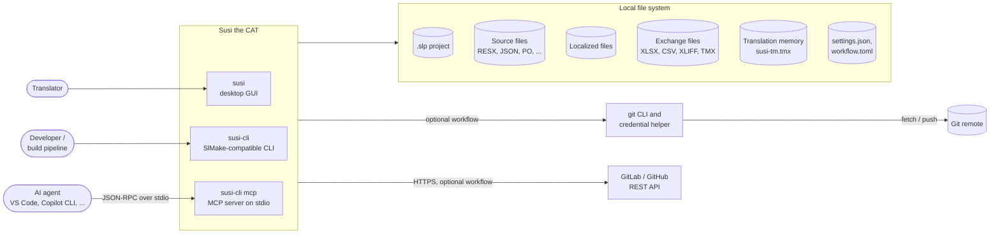

| Program        | Users                              | Purpose                                                                       |
|----------------|------------------------------------|-------------------------------------------------------------------------------|
| `susi`         | Translators, project managers      | Desktop GUI modeled on Sisulizer: project tree, translation grid, filter, dialogs |
| `susi-cli`     | Developers, CI pipelines           | Headless tasks (scan, build, export, import, validate, ...), SlMake syntax and exit codes |
| `susi-cli mcp` | AI agents                          | Model Context Protocol server exposing the same operations as tools           |

---

## 2. Workspace layout

The repository is a single Cargo workspace (edition 2024, Rust ≥ 1.95). All business logic lives
in library crates; the two binaries are thin front ends over them.

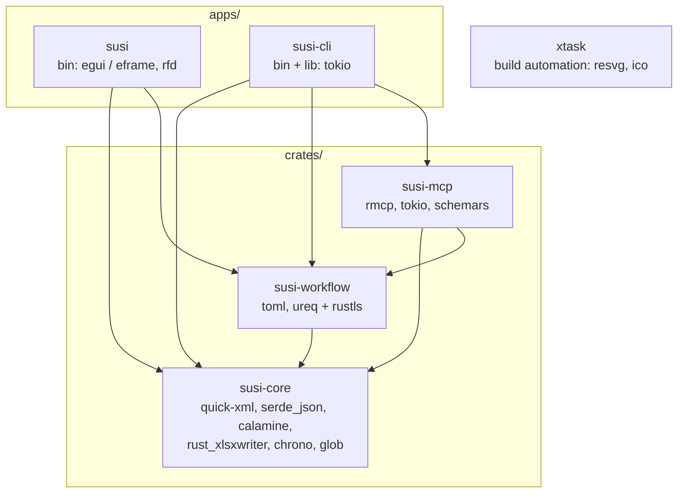

| Path            | Crate           | Responsibility                                                                                   |
|-----------------|-----------------|--------------------------------------------------------------------------------------------------|
| `crates/core`   | `susi-core`     | Project model, `.slp` persistence, file formats (scan/build), TM, exchange, validation, statistics, pseudo translation, filters, settings, UI localization |
| `crates/workflow` | `susi-workflow` | Git workflow for translators: fetch, save to a personal branch, merge/pull requests            |
| `crates/mcp`    | `susi-mcp`      | MCP server (rmcp) exposing a project session as tools                                            |
| `apps/susi`     | `susi`          | Desktop GUI (egui immediate mode)                                                                |
| `apps/susi-cli` | `susi-cli`      | Command line front end; also hosts the MCP server (`mcp` task)                                   |
| `xtask`         | `xtask`         | `cargo xtask ci / dist / help / sbom / icons / set-version / fmt / lint / test`                  |
| `assets/`       | –               | App icon master (`susi.svg`) and rendered `.ico`/`.png`, embedded by `apps/*/build.rs`           |
| `testdata/`     | –               | Anonymized fixtures: demo projects and 193 further `.slp` files for round-trip tests             |

Dependency rules:

- `susi-core` depends on no other workspace crate. Everything else builds on it.
- `susi-workflow` only needs the project model from `susi-core` (to know which files belong to a
  project); it knows nothing about the GUI, CLI or MCP.
- The front ends (`susi`, `susi-cli`, `susi-mcp`) orchestrate: they call `susi-core` operations and
  `susi-workflow` actions, but contain no format or git logic of their own.
- `xtask` is a standalone build helper and is not linked into any shipped binary.

---

## 3. Core library (`susi-core`)

### 3.1 Modules

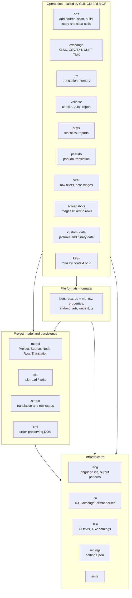

| Module      | Purpose                                                                                           |
|-------------|---------------------------------------------------------------------------------------------------|
| `model`     | Typed in-memory project; untyped parts kept verbatim (see [3.2](#32-project-model))               |
| `slp`       | Parse and serialize `.slp` files byte-faithfully (BOM, CRLF, entities, Sisulizer's `#c`/`#l` line-break coding); backup `*.~slp` on save |
| `xml`       | Small DOM on top of `quick-xml` that keeps attribute order, unknown elements and whitespace       |
| `status`    | `TranslationStatus` (Not translated … Complete) and `RowStatus` (New, Changed, Unused, In use) with their `.slp` encodings |
| `ops`       | `add_source`, `scan_source`/`scan_project`, `merge_rows`, `build_project`, output path resolution; cell commands for many rows: `copy_cells` (from the original or another language, with `copy_targets` as dry run) and `clear_translations` |
| `formats::*`| One module per source type with `scan`, `build` and (where applicable) `translations` to import existing localized files |
| `tm`        | TMX 1.4 translation memory: exact and fuzzy lookup, `translate_project`, `save_to_tm`             |
| `exchange`  | Export/import of a project table to Excel, delimited text, XLIFF 1.2 and TMX, including the screenshots of the exported rows |
| `screenshots` | `ScreenshotStore`: screenshots linked to rows (with areas) in `<project>.files/`, never in the `.slp`; manifest import, refresh, prune; `ScreenshotIndex` resolves links to rows |
| `keys`      | `RowKeys`: rows by context, row id or wildcard pattern (screenshot links, MCP)                    |
| `custom_data` | Pictures and binary data (Sisulizer *Custom Data*): hex codec and 78-column wrapping, `thumbnail`, picture formats and sizes, `merge_data` for the data nodes of a scan, linked translation files (`load_translation_file`, `refresh_linked`), the `data` check |
| `validate`  | Placeholder, tag, whitespace, punctuation, length, hotkey, duplicate, control character and ICU checks; JUnit XML; `remove_excluded` drops the findings excluded in the desktop file |
| `sds`       | Sisulizer desktop file `<project>.sds` (`Project::desktop`), loaded and saved with the `.slp`: excluded validations per scope (original/translation), everything else kept as read |
| `icu`       | Light ICU MessageFormat parser (arguments, plural/select cases) used by validation                |
| `stats`     | Per-language statistics; text/HTML/JSON reports                                                   |
| `pseudo`    | Pseudo translation and pseudo languages                                                           |
| `filter`    | `RowFilter` shared by the GUI filter panel, CLI options and the MCP `list_rows` tool               |
| `lang`      | Language ids, display names and the output file name pattern language (`<iso>`, `<net>`, `<android>`, ...) |
| `i18n`      | Localization of Susi's own UI (`t`, `tf!`, `trn`), catalogs `i18n/*.tsv`                          |
| `settings`  | User settings (`settings.json`), config directory resolution                                      |

### 3.2 Project model

The model is deliberately *partially typed*: Susi interprets what it needs (languages, sources,
nodes, rows, translations) and keeps everything else as raw XML elements and ordered attribute
lists. This is what allows Susi to open a project written by Sisulizer, change a few cells and
save it without touching anything else, including source types Susi cannot scan or build.

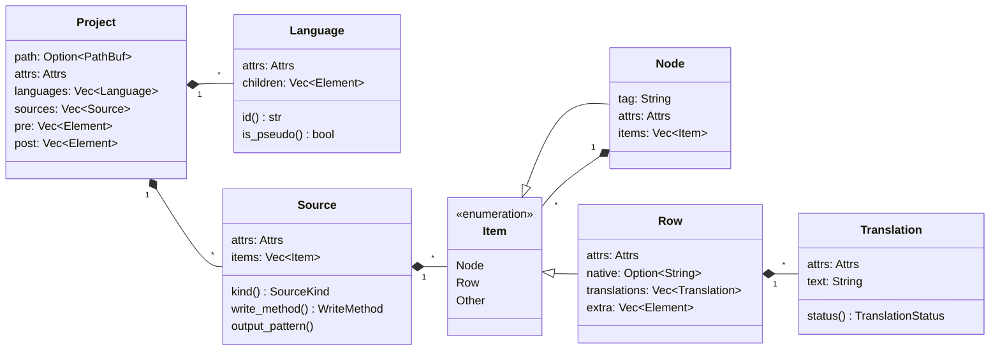

- `Attrs` is an ordered list of `(name, value)` pairs; `Element` is a verbatim XML subtree.
  `Item::Other`, `Project::pre/post`, `Language::children` and `Row::extra` hold everything Susi
  does not interpret.
- Rows are addressed by `RowRef { source, path }` (source index plus the index path through nested
  nodes); containers by `NodeRef`. GUI selection, filters, validation issues and exchange all use
  these references.
- The *context* of a row (node names and row id joined by `/`) is the human-readable key used by
  the GUI's context column, the exchange files and the MCP tools.
- Timestamps (row created, original changed, translated per language) are stored as attributes in
  local time, as Sisulizer does, and drive the date filter.
- Pictures and binary data are rows of the classes `TPictureRow` (original and translations as
  hex) and `TBinaryRow` (original only as `thumbnail`), each in a data node (`TImageDataNode`,
  `TBinaryDataNode`) named like the resource. `Row::data_kind` tells them apart; text features
  (TM, pseudo, exchange, statistics, *Copy from* for columns) skip them. `slp` writes their hex the
  way Sisulizer does (wrapped to column 78 for the depth, inline without translations), so a
  translation added by Susi looks like one added by Sisulizer.

### 3.3 File formats and the scan/build pipeline

Every source has a `SourceKind`, derived from its Sisulizer class name (`TNetResourceSource`,
`TJsonSource`, ...) or, when a source is added, from the file extension and location. `ops`
dispatches on it in two places: `scan_file` and `build_content`.

| `SourceKind`   | Class (`.slp`)          | Module               | Typical original                     |
|----------------|-------------------------|----------------------|--------------------------------------|
| `Resx`         | `TNetResourceSource`    | `formats::resx`      | `Strings.resx`, `Strings/en-US/Resources.resw` |
| `Json`         | `TJsonSource`           | `formats::json`      | `assets/i18n/en.json`                |
| `Po`           | `TPoSource`             | `formats::po`, `formats::mo` | `locale/messages.pot`        |
| `Tsv`          | `TTsvSource` *(Susi)*   | `formats::tsv`       | `de-core.tsv`                        |
| `Properties`   | `TJavaResourceSource`   | `formats::properties`| `Messages.properties`                |
| `Android`      | `TAndroidValuesSource`  | `formats::android`   | `res/values/strings.xml`             |
| `Arb`          | `TArbSource` *(Susi)*   | `formats::arb`       | `lib/l10n/app_en.arb`                |
| `WebExtension` | `TWebExtensionSource` *(Susi)* | `formats::webext` | `_locales/en/messages.json`        |
| `QtTs`         | `TQtTsSource` *(Susi)*  | `formats::ts`        | `i18n/app_de.ts`                     |
| `Other`        | any other class         | –                    | preserved, neither scanned nor built |

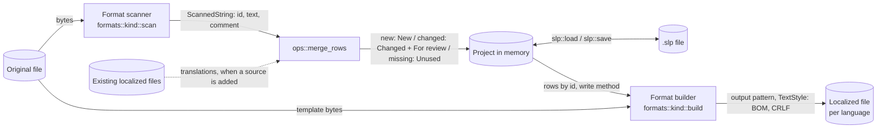

- **Scan** turns an original file into a flat list of `ScannedString { id, text, comment }` and
  merges it into the source's rows: new ids become *New* rows, a changed original marks the row
  *Changed* and its translations *For review*, ids no longer present become *Unused*.
- **RESX** additionally yields custom data (`resx::scan_all`: embedded byte arrays and file
  references, `ScannedData`), which `custom_data::merge_data` keeps in one data node per
  resource (picture or binary by content, like Sisulizer); text file references become strings.
  The build embeds translated data (`build_bytes`) and writes text references as strings.
- **Build** never generates a file from scratch: it copies the original and substitutes the
  translated values (`select_output` applies the write method *All / Translated / Different*).
  Comments, order, indentation, BOM and line endings of the original are preserved, so diffs of
  localized files stay minimal.
- Output paths are computed from the source's `<outputfile>` pattern (`lang::expand_pattern`).
- Pseudo languages are built from on-the-fly pseudo translations of untranslated cells.

Adding a new source type therefore means: a `formats::<name>` module with `scan`/`build`
(and `translations` for import of existing files), a `SourceKind` variant with its class name and
detection rule, the two `match` arms in `ops`, a default output pattern, and the type keyword in
the CLI `add -type:` option.

---

## 4. Desktop GUI (`susi`)

The GUI is an [egui](https://github.com/emilk/egui)/eframe immediate-mode application. All state
lives in one struct, `SusiApp` (`app.rs`); the UI is re-rendered from that state on every frame.

| Module           | Responsibility                                                                  |
|------------------|---------------------------------------------------------------------------------|
| `main.rs`        | Window setup, starts `SusiApp` with an optional `.slp` argument                 |
| `window.rs`      | Window layout: geometry and panel sizes restored from `window.ron` (eframe persistence), window fitted to the monitor on the first start |
| `help.rs`        | Context help: `F1` maps the open dialog, bottom tab or pointed panel to a page of the user guide (`docs/user`), local guide first, then online |
| `app.rs`         | `SusiApp` state: project, TM, selection, filter, sort, log, issues, dialogs, settings |
| `panels.rs`      | Menu bar, toolbar, project tree, filter panel, status bar; the row and column commands shared with the context menus |
| `grid.rs`        | Central translation sheet: columns, in-cell editing, sorting, column widths, context menus of cells and column headers |
| `bottom.rs`      | Bottom tabs: output, validation, search, statistics, comments, editor with TM suggestions |
| `list.rs`        | Reusable scrollable/resizable list used by the bottom tabs                      |
| `dialogs.rs`     | Modal dialogs: languages, add source, source/row properties, export, import, TM, pseudo, options |
| `actions.rs`     | `Action` enum and `run_actions`: the only place that mutates the project         |
| `workflow_ui.rs` | Git workflow state display, background jobs and the workflow dialogs           |
| `shots.rs`       | Screenshots: bottom tab with marked areas, paste and drag & drop, screenshot manager |
| `data_ui.rs`     | Pictures and binary data: editor tab with previews or hex dump, load/link/save files, cell texts |
| `watch.rs`       | Watch of the open `.slp`: a background thread polls modification time and size, the UI compares content hashes and asks to reload (*Project changed*) |
| `tests.rs`       | Headless rendering tests against real projects                                   |

### 4.1 Frame loop and action queue

Widgets never call `susi-core` directly. Menus, toolbar buttons, context menus and shortcuts push
an `Action` (e.g. `Scan`, `Build`, `SetStatus(..)`, `Workflow(..)`) into a queue; `run_actions`
executes the queue at the end of the frame. This keeps rendering free of side effects, gives one
place for the unsaved-changes guard and makes the GUI testable headlessly.

Row and column commands are built by the same functions (`panels::row_menu_items`,
`panels::column_items`), so they have the same names and order in the menus *Row*, *Column* and
*Edit* and in the context menus of cells and column headers. Row actions change the selected cell;
column actions (`SetStatusIn`, `CopyInColumn`, `ClearColumn`) take the visible rows and open a
dialog with the affected cell counts or a confirmation before calling `ops`.

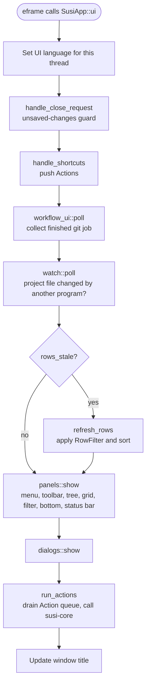

### 4.2 Background git jobs

Git and server calls can take seconds, so the workflow runs them on a worker thread. Only one job
runs at a time; read-only jobs (status refresh) may be replaced, write jobs block new ones.

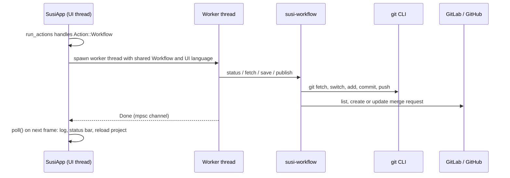

---

## 5. Command line (`susi-cli`)

`susi-cli` is a library (`lib.rs`, used by the integration tests) plus a five-line `main.rs`.
It follows SlMake's syntax (`-opt:value`, also `--opt=value`), task names and exit codes, so it
can replace SlMake in existing build pipelines.

| Module        | Responsibility                                                              |
|---------------|-----------------------------------------------------------------------------|
| `args.rs`     | Parses tasks, project path and options into an `Invocation`                 |
| `help.rs`     | General and per-task help texts                                             |
| `tasks.rs`    | One function per task; `Output` message sink with SlMake semantics          |
| `workflow.rs` | `workflow` task: `init`, `config`, `status`, `fetch`, `save`, `publish`, `login`, `logout` |
| `screenshot.rs` | `screenshot` task: `list`, `add`, `link`, `unlink`, `remove`, `prune`, `refresh`, `import` |

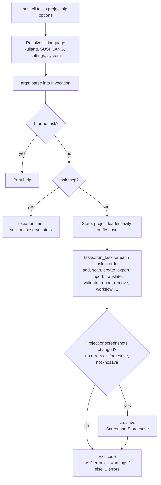

Tasks share one `State`, so `susi-cli scan create validate app.slp` loads the project once and
saves it once at the end. A failing task stops the chain; the project is then not saved unless
`-forcesave` is given.

Tasks call the same `susi-core` functions as the GUI commands, so both follow the same rules; for
example `copy` (`-from:de -lang:de-CH`) uses `ops::copy_cells` like *Copy from* in the GUI.

---

## 6. MCP server (`susi-mcp`)

`susi-cli mcp [project.slp]` starts a [Model Context Protocol](https://modelcontextprotocol.io)
server on stdin/stdout, built with the official Rust SDK `rmcp`. The crate is split into a thin
protocol layer and a transport-independent session that holds the actual logic.

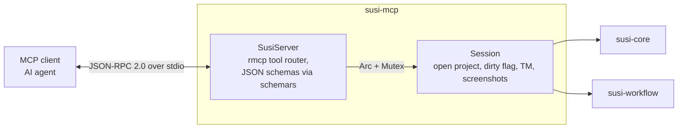

- `server.rs` declares the 31 tools with `#[tool]` attributes and input structs deriving
  `JsonSchema`; each tool locks the session and delegates.
- `session.rs` returns `serde_json::Value` results and is unit-testable without a transport.
  `get_screenshot` is the only tool with image content (base64 PNG/JPEG plus a JSON text).
- Rows are addressed by their context key (plus the source index if ambiguous), resolved by
  `susi_core::keys::RowKeys`.
- Tool output is always English, regardless of the user's UI language. Nothing but protocol
  messages may be written to stdout.

| Group         | Tools                                                                       |
|---------------|-----------------------------------------------------------------------------|
| Project       | `open_project`, `create_project`, `save_project`, `project_info`, `add_language`, `add_source` |
| Rows          | `list_rows`, `get_row`, `set_translations`, `set_status`, `set_row_properties`, `copy_translations` |
| Screenshots   | `get_screenshot`, `attach_screenshot`, `detach_screenshot`                  |
| Pictures, binary data | `get_picture`, `load_translation_file`                            |
| Operations    | `scan`, `build`, `validate`, `statistics`, `fill_pseudo`                    |
| TM / exchange | `tm_translate`, `tm_lookup`, `tm_save`, `export`, `import`                  |
| Git workflow  | `workflow_status`, `workflow_fetch`, `workflow_save`, `workflow_publish`    |

---

## 7. Git workflow (`susi-workflow`)

The workflow lets translators work in a git working copy without knowing git. A developer
prepares the working copy and commits `.susi/workflow.toml`; translators then use three actions:
*Get translation project*, *Save changes* and *Prepare publication*. GUI, CLI and MCP all call the
same `Workflow` facade.

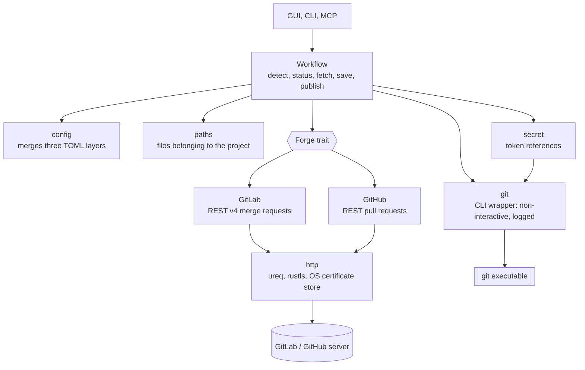

| Module      | Responsibility                                                                                     |
|-------------|----------------------------------------------------------------------------------------------------|
| `flow`      | `Workflow` facade, `State` derivation, fetch/save/publish, merge request cache                    |
| `config`    | Merges user (`%APPDATA%\susi\workflow.toml`), repository (`.susi/workflow.toml`) and working copy (`.git/susi/workflow.local.toml`) settings |
| `git`       | Runs `git` as a subprocess with prompts disabled; records commands for display                    |
| `paths`     | Determines which files to commit: the `.slp`, its sources and outputs, `git.paths` – nothing else |
| `forge`     | `Forge` trait (`current_user`, `members`, `merge_requests`, `create/update_merge_request`), provider detection from the remote URL |
| `gitlab`, `github` | `Forge` implementations                                                                     |
| `http`      | Shared JSON HTTP client                                                                            |
| `secret`    | `TokenRef` (`auto`, `env:NAME`, `credential[:user]`, `none`); tokens live in git's credential helper, never in config files |

### 7.1 Workflow state

The status bar shows a state derived from the working copy and, when online, from the server.
`Detached` is entered when a specific commit or tag is checked out (read-only).

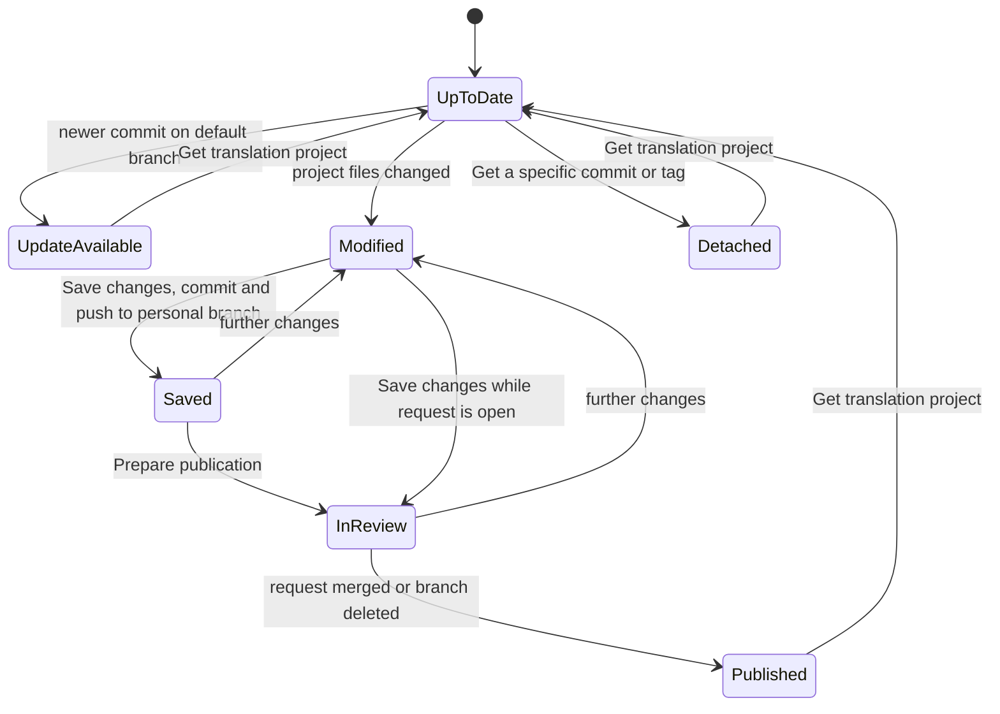

| State             | Label in the UI                    |
|-------------------|------------------------------------|
| `UpToDate`        | Up to date                         |
| `UpdateAvailable` | Update available                   |
| `Modified`        | Changes not saved on the server    |
| `Saved`           | Saved, not published               |
| `InReview`        | In review                          |
| `Published`       | Published                          |
| `Detached`        | Fixed version                      |

### 7.2 Save and publish

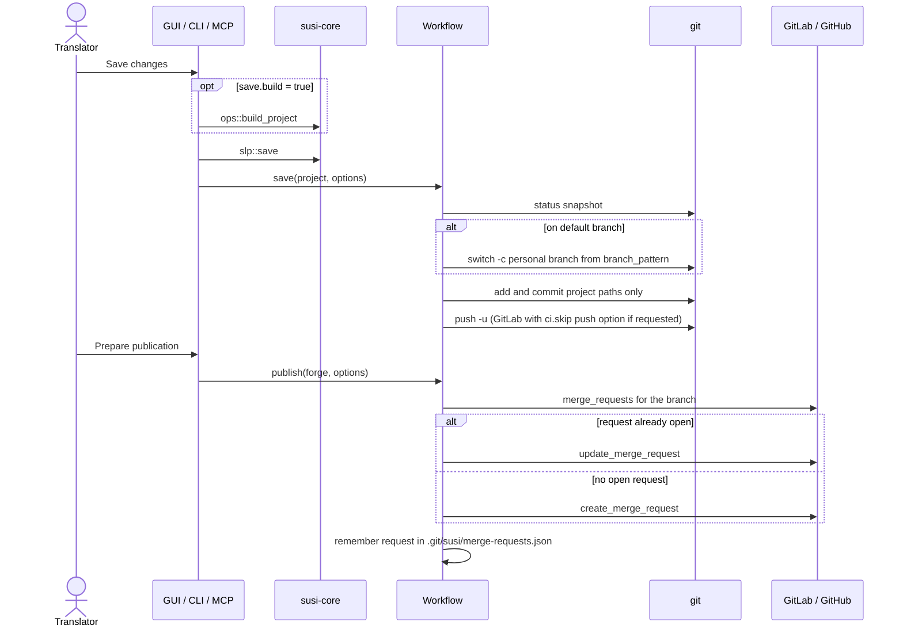

*Get translation project* runs `git fetch`, sets uncommitted changes aside with `git stash` and
unpushed commits in a backup ref (`refs/susi/backup/...`), then switches to the latest commit of
the default branch. Nothing a translator did is lost silently.

---

## 8. Cross-cutting concerns

### 8.1 File fidelity

Compatibility with existing Sisulizer projects is the central constraint:

- `.slp` files written by Sisulizer 4.0.353 or newer are reproduced byte for byte when nothing was
  changed; the round-trip test covers all fixtures in `testdata/`.
- `xml` keeps attribute order, unknown elements and whitespace; `model` stores everything it does
  not interpret verbatim.
- Builders copy the original file and only replace values; `TextStyle` restores BOM, CRLF and the
  trailing newline of the original.
- Before overwriting a project, `slp::save` keeps the previous version as `*.~slp`.
- Data Sisulizer does not know stays out of the `.slp`: Sisulizer drops unknown elements and
  attributes when it saves a project (verified with SlMake 4.0.374). Screenshots therefore live
  in `<project>.files/`, and their links address rows by source and context so they survive
  scans; links to vanished rows are reported as orphaned.
- Pictures and binary data, by contrast, are stored like Sisulizer stores them (hex in the
  `.slp`, translations linked via `filename`/`filedate`), verified against SlMake 4.0.374 with the
  fixture `testdata/projects/custom-data/`. Linked files are compared by content, so checkouts do
  not change the project.

### 8.2 User interface localization

- Texts in the code are English and serve as lookup keys: `t("...")`, `tf!("... {x}", x = ..)`,
  `trn(n, one, other)`, `tr_ctx(context, ...)`.
- The German catalogs `crates/core/src/i18n/de-*.tsv` are embedded with `include_str!`; missing
  entries fall back to English. A unit test checks completeness, orphans and placeholders.
- The current language is thread-local. The GUI sets it every frame and passes it to worker
  threads; the MCP server keeps English.
- Susi maintains its own catalogs as a Susi project (`i18n/susi-i18n.slp` with TSV sources).

### 8.3 Configuration and stored data

| What                     | Location                                         | Written by                |
|--------------------------|--------------------------------------------------|---------------------------|
| User settings            | `%APPDATA%\susi\settings.json` (override: `SUSI_CONFIG_DIR`) | GUI                |
| Window layout            | `%APPDATA%\susi\window.ron` (position, size, maximized, panel sizes) | GUI (eframe) |
| Translation memory       | `%APPDATA%\susi\susi-tm.tmx` (configurable, CLI `-tm:`) | GUI, CLI, MCP      |
| Workflow configuration   | user, `.susi/workflow.toml`, `.git/susi/workflow.local.toml` | developer, `workflow init` |
| Merge request cache      | `.git/susi/merge-requests.json`                  | `susi-workflow`           |
| Forge token              | git credential helper (Windows Credential Manager) or `SUSI_FORGE_TOKEN` | *Sign in*, `workflow login` |
| UI language override     | `SUSI_LANG`, CLI `-uilang:`                      | user                      |
| Screenshots              | `<project>.files/screenshots.json` and `screenshots/` next to the `.slp` | GUI, CLI, MCP (with the project) |
| Linked translation files | anywhere, `filename` relative to the `.slp` (pictures and binary data) | translator; read by GUI, CLI, MCP |

### 8.4 Error handling and code rules

- Library errors are typed with `thiserror` (`susi_core::Error`, `susi_workflow::Error`) and
  converted to messages at the front ends.
- `susi-core` and `susi-workflow` deny `unwrap`, `expect`, `panic!`, `todo!`, `unimplemented!` and
  `unreachable!`; `unsafe` code is forbidden workspace-wide.
- Clippy denies high cognitive complexity, too many arguments and wildcard imports.

### 8.5 Security

- Configuration files hold only token *references*; values that look like tokens (`glpat-…`,
  `ghp_…`, `github_pat_…`) are rejected.
- Git runs non-interactively (`GIT_TERMINAL_PROMPT=0`, `GCM_INTERACTIVE=never`); recorded commands
  never include credentials.
- HTTPS uses rustls with the operating system's certificate store, so self-hosted servers with
  company CAs work without extra configuration.
- The workflow commits only files that belong to the project, never other changes in the working
  copy.

### 8.6 Concurrency

| Front end | Model                                                                                     |
|-----------|-------------------------------------------------------------------------------------------|
| GUI       | Single UI thread; at most one git worker thread, results returned through an `mpsc` channel; one thread polling the project file, which only wakes the UI (`request_repaint`) |
| CLI       | Sequential tasks on the main thread                                                       |
| MCP       | Multi-threaded tokio runtime; tool calls serialized by `Arc<Mutex<Session>>`              |

`susi-core` itself is synchronous and has no global mutable state apart from the thread-local UI
language.

---

## 9. Testing

| Level             | Location                          | What it covers                                                        |
|-------------------|-----------------------------------|-----------------------------------------------------------------------|
| Unit tests        | `#[cfg(test)]` in most modules    | Parsers, builders, patterns, filters, status logic, i18n catalogs     |
| Core integration  | `crates/core/tests/ops.rs`        | Scan/build of the demo projects, expected drift, RESX build vs. Sisulizer output |
| Round trip        | `crates/core/tests/samples.rs`    | Load and save all `.slp` fixtures, byte-identical or stable           |
| Custom data       | `crates/core/tests/custom_data.rs` | RESX pictures and binary data: scan and build compared with Sisulizer's results, linked files, excluded types |
| Workflow          | `crates/workflow/tests/flow.rs`   | End to end with real git repositories (bare "server", developer and translator clones) and a fake `Forge` |
| MCP               | `crates/mcp/tests/mcp.rs`         | rmcp client against `SusiServer` over an in-memory duplex stream      |
| CLI               | `apps/susi-cli/tests/cli.rs`      | Task chains and exit codes through `susi_cli::run_with`               |
| GUI               | `apps/susi/src/tests.rs`          | Headless frames of the full UI against real projects                  |

All tests work on copies in temporary directories; `testdata/` is never modified. `cargo xtask ci`
runs rustfmt, clippy (`-D warnings`) and all tests.

---

## 10. Build, CI and release

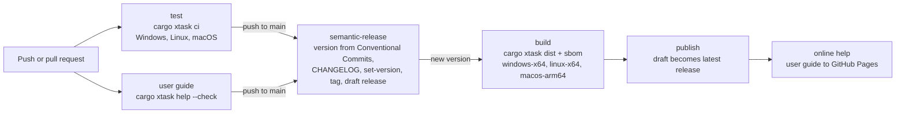

- `xtask` bundles the build automation: `ci`, `fmt`, `lint`, `test`, `dist` (release build with
  embedded icon and version info, user guide in `dist/help/`), `help` (user guide, see
  [maintaining the user guide](user-guide.md)), `sbom` (CycloneDX per application via
  cargo-cyclonedx), `icons` (renders `susi.svg` to `.ico`/`.png`) and `set-version`.
- `apps/*/build.rs` embed icon and version resources into the Windows executables via `winresource`.
- Release archives contain `susi`, `susi-cli`, their SBOMs, the user guide (`help/en`, `help/de`),
  `README.md` and `CHANGELOG.md`, each with a `.sha256` checksum.
