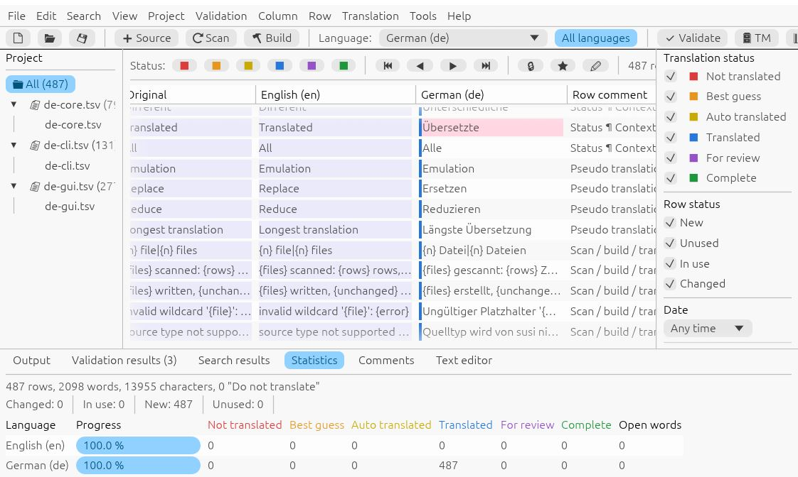

# Welcome to Susi

Susi the CAT is a translation tool for software. CAT stands for *computer-assisted translation*:
Susi does not translate by itself, it helps you translate the texts of a program – menus,
dialogs, messages – quickly, consistently and without breaking anything.

## What Susi does for you

- It shows all texts of a program in one table: the original next to its translations.
- It keeps track of what is translated, what still needs work and what has changed since your
  last visit.
- It checks your translations, for example for a missing placeholder or a missing period.
- It remembers your translations and suggests them again for equal or similar texts.
- It shows screenshots, so you know where a text appears and how much space it has.
- It creates the translated files that the developers build into the program.

## Who this help is for

This help is written for translators, reviewers and everybody else who works with the Susi
desktop application. You do not need to know how the program you translate is made. Developers
find the technical details (command line, file formats, automation) in the
[project description on GitHub](https://github.com/mcpride/susi-the-cat#readme).

## Where to start

- New to Susi? Read [Installation and first start](getting-started.md) and then
  [Your first project](first-project.md).
- Somebody gave you a project file (`.slp`)? Open it with *File › Open…* and continue with
  [Translating texts](translating.md).
- Press `F1` in Susi at any time to open the help page for the part of the window you are
  working in.

## Susi and Sisulizer

Susi is a new, independent development for the projects of *Sisulizer*, a translation tool that
is no longer developed. Susi opens and saves Sisulizer project files directly, and its window is
arranged in a similar way. If you know Sisulizer, you will quickly find your way around.
