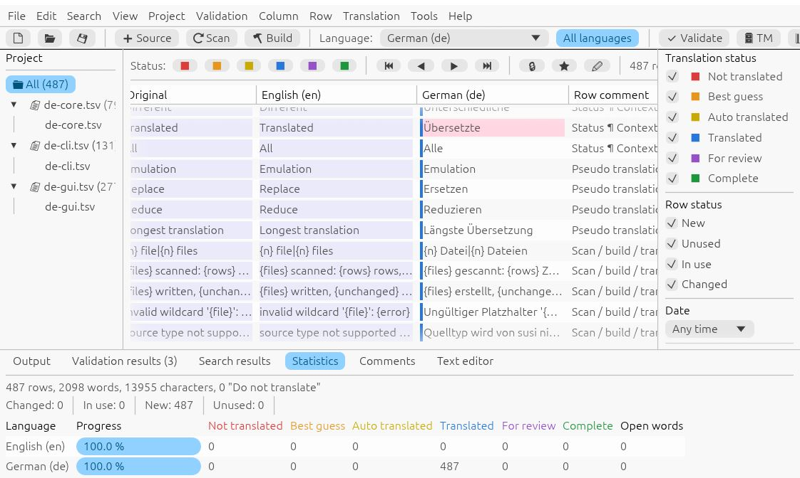

# The main window

The window has these parts:

| Part | What it is for |
|---|---|
| Menu bar | All commands, sorted by topic. |
| Toolbar | Frequently used commands and the current language. |
| [Project tree](project-tree.md) (left) | The files of the project and their structure. A click shows only the texts of that part. |
| [Translation sheet](sheet.md) (center) | The texts with original, translations and status. This is where you translate. |
| [Filter bar](filter.md) (right) | Shows only the texts you need, for example only the untranslated ones. |
| Output area (bottom) | Tabs for the [output](output.md), [validation results](validation.md), [search results](search.md), [statistics](statistics.md), [comments](comments.md), the [text editor](text-editor.md) and [screenshots](screenshots.md). |
| Status bar | The selected row, an active filter, unsaved changes and the file of the selected text. |

## Showing and hiding panels

The menu *View* switches the project tree, the filter bar and the output area on and off. To
change the size of a panel, drag its edge with the mouse. Susi remembers the sizes for the next
start.

## The toolbar

| Button | Command |
|---|---|
| 🗋 🗁 💾 | New project, open project, save |
| ➕ Source | Add a file with original texts |
| ⟳ Scan | Read the source files again and take over the changes (`F5`) |
| 🔨 Build | Write the translated files (`F9`) |
| Language | The current language, the language you translate into |
| All languages | Show all languages side by side, or only the current language |
| ✔ Validate | Check the translations |
| 🗄 TM | Translate with the translation memory |
| 📊 | Statistics |

If the project is part of a prepared git working copy, the toolbar also shows the buttons of the
[git workflow](git-workflow.md).

## The status bar

- `12 / 340`: the selected row and the number of rows shown.
- *Filter active*: not all rows are shown, because a filter is set or a part of the project tree
  is selected.
- *Modified*: the project has unsaved changes.
- At the end: the file of the selected text, otherwise the project file.

With the git workflow, the status bar also shows its state, see [Git workflow](git-workflow.md).
